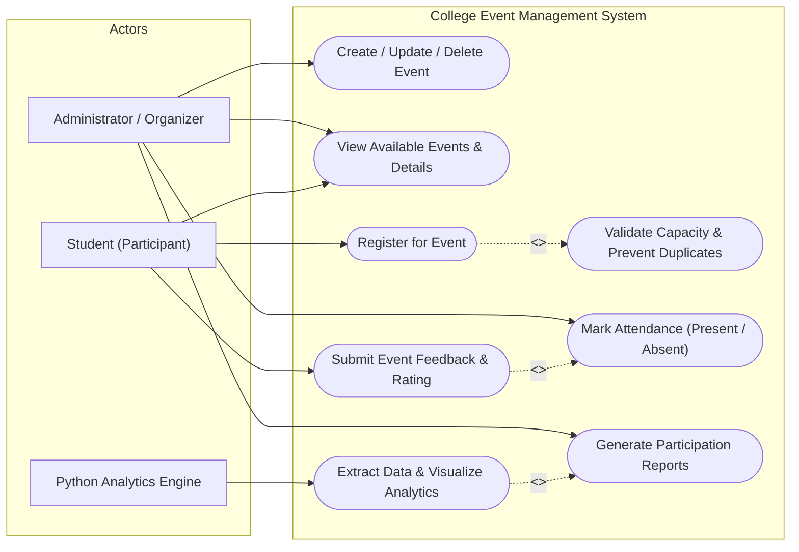
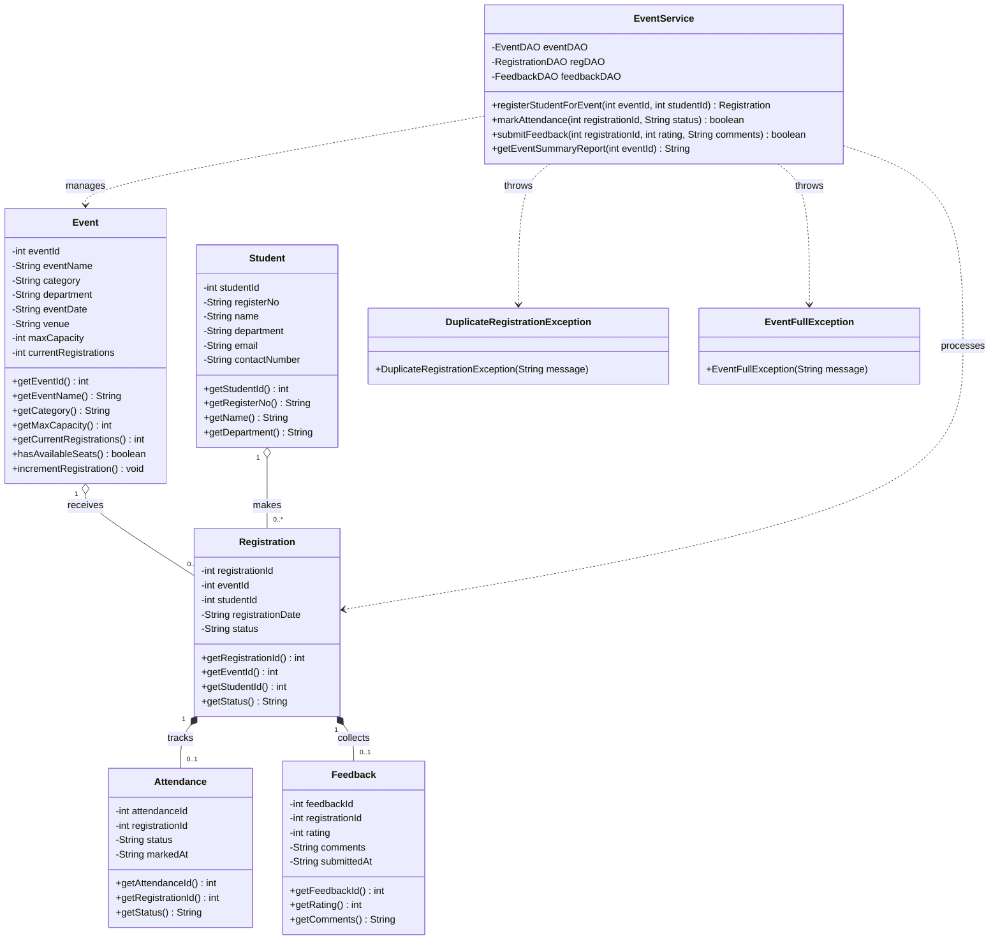
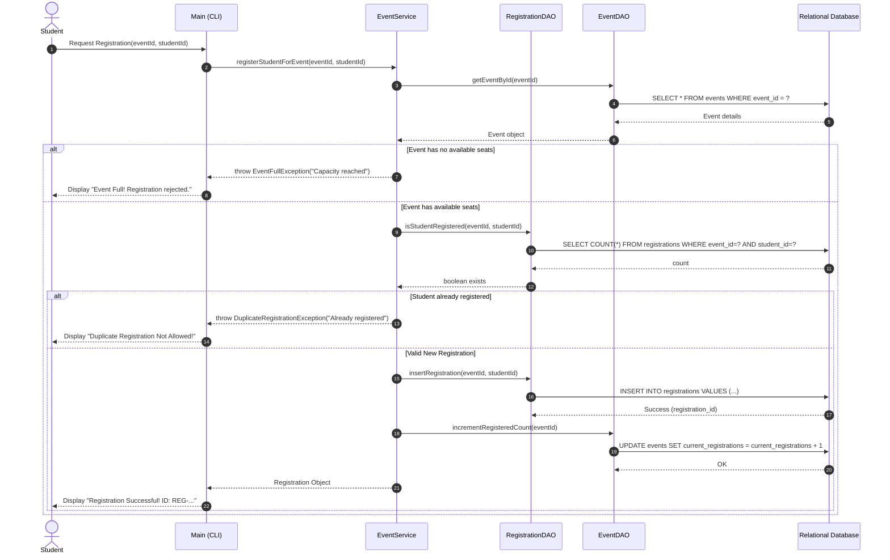
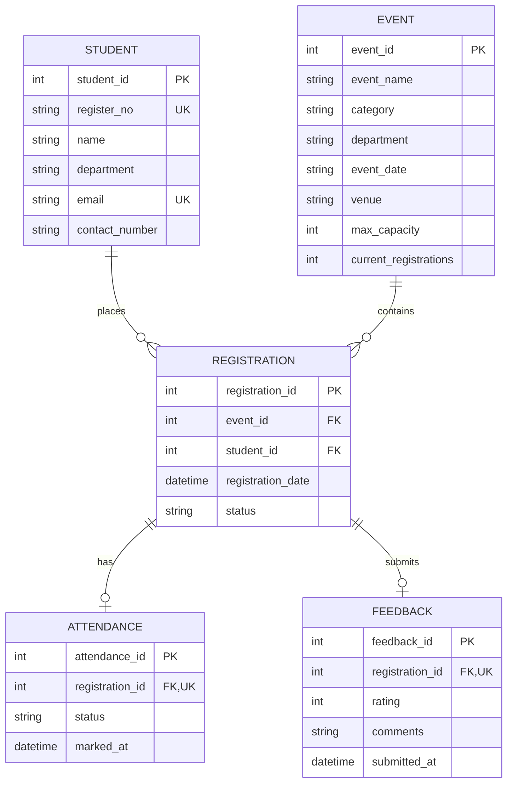

# System Design Diagrams

## College Event Management and Participation Analysis System
**Student Register No.:** 31  
**Class:** 25IT3A&B | **Course:** 25ITT33 Software Engineering & 25ITT32 Java Programming  
**Department:** Information Technology, Velalar College of Engineering and Technology  

---

## 1. Use Case Diagram

The Use Case diagram illustrates the functional interactions between the primary actors (**Administrator**, **Student**, and **Data Analyst / Python Engine**) and the system boundaries.

---

## 2. UML Class Diagram

The Class Diagram reflects the Object-Oriented design implemented in the Java source code (`com.eventmanagement.*`), demonstrating encapsulation, inheritance, interfaces, associations, and custom exceptions.

---

## 3. Sequence Diagram: Student Event Registration

This sequence diagram depicts the transaction flow when a student attempts to register for an event, illustrating business validations (capacity check and duplicate check).

---

## 4. Entity-Relationship (ER) Diagram

